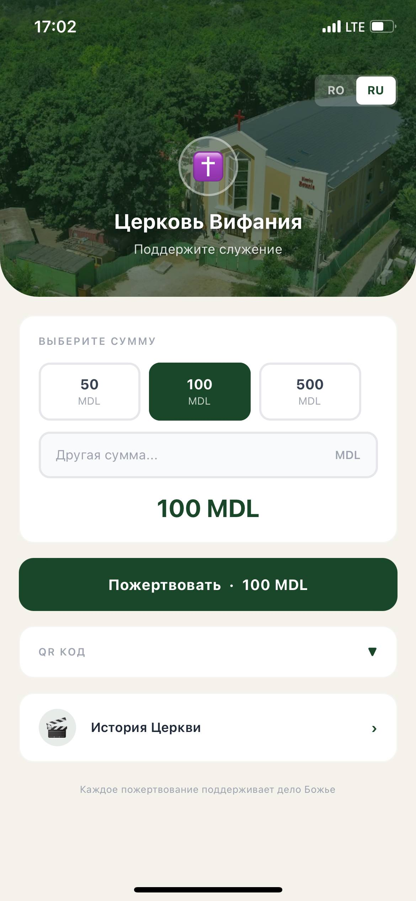
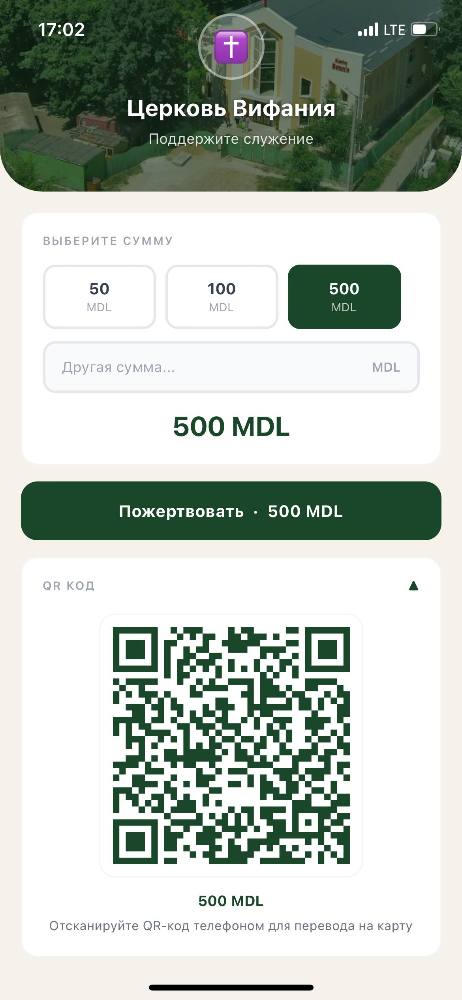
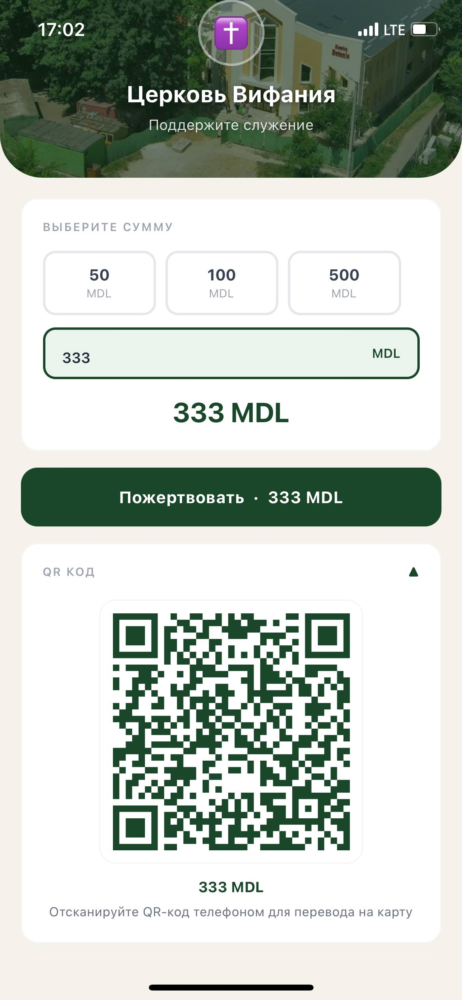
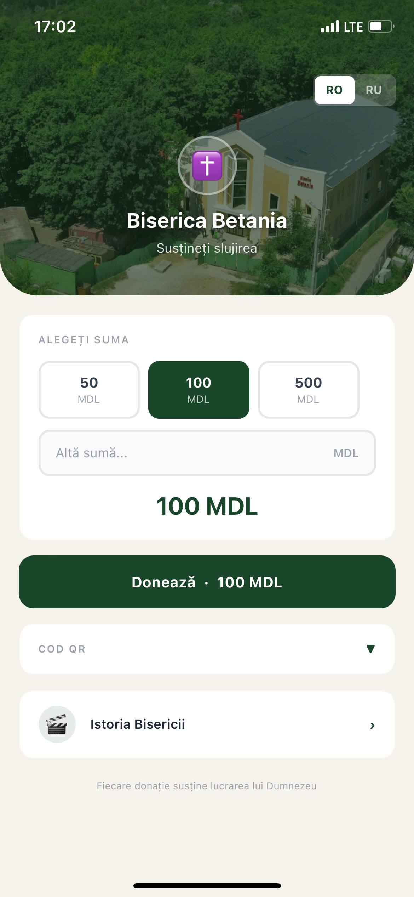
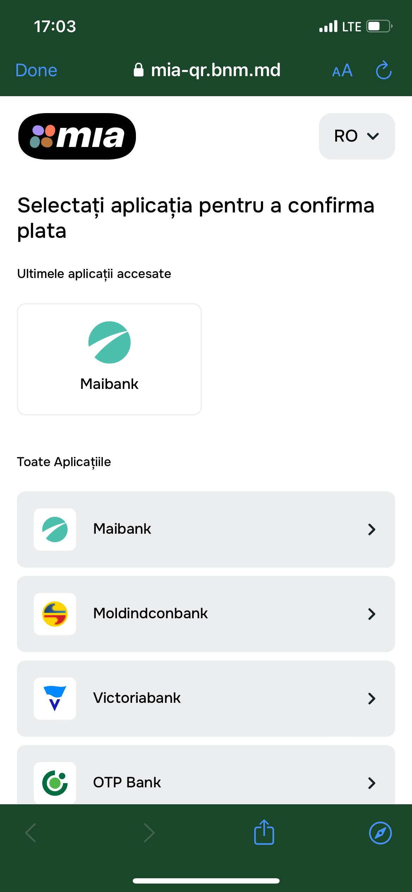
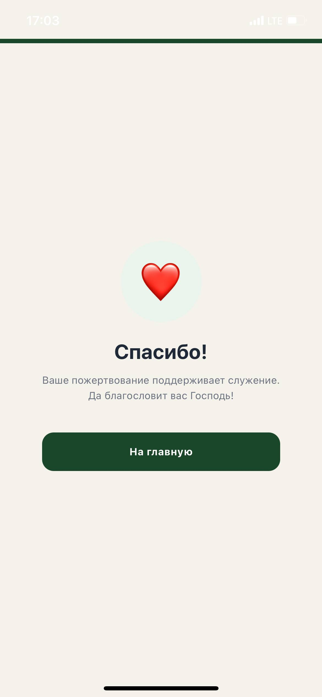
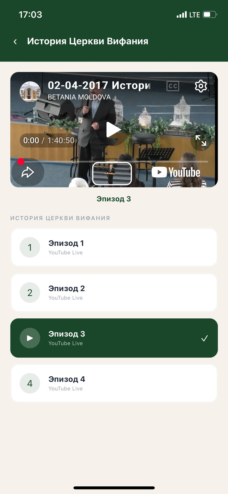

# BisBetania

Мобильное приложение для церкви Betania: быстрый экран пожертвований с выбором суммы, QR-кодом, переходом в MIA-платеж и отдельным разделом с историей церкви через YouTube.

## Возможности

- выбор фиксированной суммы пожертвования: `50`, `100`, `500 MDL`;
- ввод своей суммы вручную;
- генерация QR-кода под выбранную сумму;
- переход на MIA payment link через встроенный браузер;
- копирование выбранной суммы в буфер обмена;
- экран благодарности после пожертвования;
- переключение языка интерфейса `RU / RO`;
- раздел "История Церкви" с YouTube-видео;
- адаптированный мобильный дизайн под iOS/Android.

## Технологии

- React Native;
- Expo;
- Expo Router;
- TypeScript;
- NativeWind / Tailwind CSS;
- `react-native-qrcode-svg` для QR-кода;
- `expo-web-browser` для открытия MIA payment page;
- `expo-clipboard` для копирования суммы;
- `react-native-youtube-iframe` для видеораздела.

## Скриншоты работы

| Главный экран RU | QR-код | Своя сумма | Интерфейс RO |
| --- | --- | --- | --- |
|  |  |  |  |

| MIA оплата | Спасибо | История церкви |
| --- | --- | --- |
|  |  |  |

## Запуск проекта

Перед запуском нужен установленный Node.js и Expo development environment.

```bash
git clone https://github.com/cs1lyuha/bisbetania.git
cd bisbetania
npm install
npx expo start
```

После запуска Expo можно открыть приложение:

- через Expo Go, отсканировав QR-код в терминале;
- на Android-эмуляторе;
- на физическом Android-устройстве;
- через development build.

Для запуска Android build из проекта:

```bash
npm run android
```

## Проверка

TypeScript-проверка:

```bash
npx tsc --noEmit
```

Expo start:

```bash
npx expo start
```

## Структура

```text
app/
  index.tsx       главный экран пожертвований
  thank-you.tsx   экран благодарности
  istoria.tsx     история церкви и YouTube-видео
assets/
  images/         иконка, фон церкви, QR asset
components/
  LanguageToggle.tsx
config/
  links.ts        MIA payment link и суммы пожертвования
i18n/
  translations.ts переводы RU/RO
docs/
  screenshots/    доказательство работы приложения
```

## Автор

[cs1lyuha](https://github.com/cs1lyuha).
