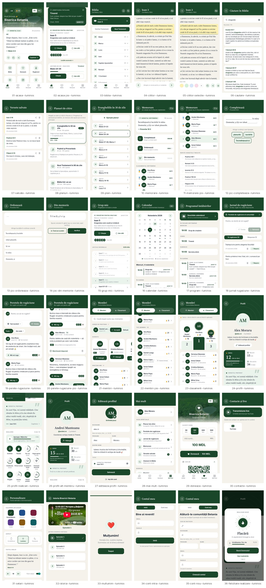
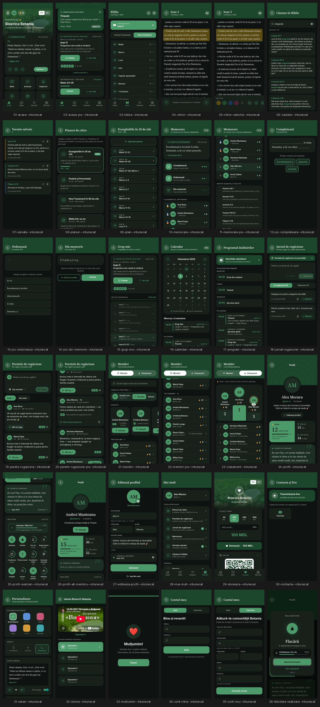

# Capturile ecranelor · BisBetania 1.2

Capturi ale aplicației actuale, pentru designer. Merg împreună cu [`../DESIGN-BRIEF.md`](../DESIGN-BRIEF.md).

> **Redesign P2 implementat:** profilul, membrii și clasamentul, peretele de rugăciune și felicitarea urmează planșele din [`BisBetania-Redesign-P2-P4.pdf`](BisBetania-Redesign-P2-P4.pdf) (notițele: [`REDESIGN-P2-P4-NOTE.md`](REDESIGN-P2-P4-NOTE.md)). Capturile de mai jos arată noul design; antetul nou e pe toate ecranele.

- **Format:** iPhone 390×844 pt, rezoluție 2× (780×1688 px), cu zonele sigure ale unui iPhone (notch și bara de jos).
- **92 capturi, 36 ecrane:** fiecare în **luminos** și **întunecat** (accentul implicit, verde Betania). Ecranele-cheie sunt și în **rusă**, iar câteva sunt în celelalte **5 culori de accent**, ca dovadă că sistemul ține.
- **Datele comunității sunt inventate:** membri, cereri de rugăciune, clasamente. Nu sunt oameni reali. Data e 29 octombrie 2026.
- **Randarea e făcută de motorul web al aplicației** (React Native Web în Chrome). Pe telefon diferă puțin:
  - fontul sistemului (SF Pro pe iPhone)
  - bara de stare (ora, bateria) lipsește
  - umbrele sunt mai fine

## Dintr-o privire
| Luminos | Întunecat |
|---|---|
|  |  |

## Toate ecranele
| # | Ecran | Variante |
|---|---|---|
| 01 | Acasă | [luminos](screens/01-acasa--luminos.jpg) · [întunecat](screens/01-acasa--intunecat.jpg) · [RU](screens/01-acasa--ru-luminos.jpg) · [violet ☾](screens/01-acasa--violet-intunecat.jpg) · [ocean](screens/01-acasa--ocean-luminos.jpg) · [burgundy](screens/01-acasa--burgundy-luminos.jpg) · [amber ☾](screens/01-acasa--amber-intunecat.jpg) · [teal](screens/01-acasa--teal-luminos.jpg) |
| 02 | Acasă (derulat) | [luminos](screens/02-acasa-jos--luminos.jpg) · [întunecat](screens/02-acasa-jos--intunecat.jpg) |
| 03 | Biblia | [luminos](screens/03-biblia--luminos.jpg) · [întunecat](screens/03-biblia--intunecat.jpg) |
| 04 | Cititorul | [luminos](screens/04-cititor--luminos.jpg) · [întunecat](screens/04-cititor--intunecat.jpg) |
| 05 | Cititorul, verset selectat | [luminos](screens/05-cititor-selectie--luminos.jpg) · [întunecat](screens/05-cititor-selectie--intunecat.jpg) |
| 06 | Căutare în Biblie | [luminos](screens/06-cautare--luminos.jpg) · [întunecat](screens/06-cautare--intunecat.jpg) |
| 07 | Versete salvate | [luminos](screens/07-salvate--luminos.jpg) · [întunecat](screens/07-salvate--intunecat.jpg) |
| 08 | Planuri de citire | [luminos](screens/08-planuri--luminos.jpg) · [întunecat](screens/08-planuri--intunecat.jpg) |
| 09 | Un plan de citire | [luminos](screens/09-plan--luminos.jpg) · [întunecat](screens/09-plan--intunecat.jpg) |
| 10 | Memorare | [luminos](screens/10-memorare--luminos.jpg) · [întunecat](screens/10-memorare--intunecat.jpg) · [RU](screens/10-memorare--ru-luminos.jpg) · [ocean](screens/10-memorare--ocean-luminos.jpg) |
| 11 | Memorare (clasament, repetare) | [luminos](screens/11-memorare-jos--luminos.jpg) · [întunecat](screens/11-memorare-jos--intunecat.jpg) |
| 12 | Joc: Completează | [luminos](screens/12-joc-completeaza--luminos.jpg) · [întunecat](screens/12-joc-completeaza--intunecat.jpg) · [RU](screens/12-joc-completeaza--ru-luminos.jpg) |
| 13 | Joc: Ordonează | [luminos](screens/13-joc-ordoneaza--luminos.jpg) · [întunecat](screens/13-joc-ordoneaza--intunecat.jpg) |
| 14 | Joc: Din memorie | [luminos](screens/14-joc-din-memorie--luminos.jpg) · [întunecat](screens/14-joc-din-memorie--intunecat.jpg) |
| 15 | Grup mic | [luminos](screens/15-grup-mic--luminos.jpg) · [întunecat](screens/15-grup-mic--intunecat.jpg) · [RU](screens/15-grup-mic--ru-luminos.jpg) |
| 16 | Calendar | [luminos](screens/16-calendar--luminos.jpg) · [întunecat](screens/16-calendar--intunecat.jpg) |
| 17 | Programul întâlnirilor | [luminos](screens/17-program--luminos.jpg) · [întunecat](screens/17-program--intunecat.jpg) |
| 18 | Jurnalul de rugăciune (personal) | [luminos](screens/18-jurnal-rugaciune--luminos.jpg) · [întunecat](screens/18-jurnal-rugaciune--intunecat.jpg) |
| 19 | Peretele de rugăciune | [luminos](screens/19-perete-rugaciune--luminos.jpg) · [întunecat](screens/19-perete-rugaciune--intunecat.jpg) · [RU](screens/19-perete-rugaciune--ru-luminos.jpg) · [violet ☾](screens/19-perete-rugaciune--violet-intunecat.jpg) · [burgundy ☾](screens/19-perete-rugaciune--burgundy-intunecat.jpg) |
| 20 | Peretele de rugăciune (derulat) | [luminos](screens/20-perete-rugaciune-jos--luminos.jpg) · [întunecat](screens/20-perete-rugaciune-jos--intunecat.jpg) |
| 21 | Membri | [luminos](screens/21-membri--luminos.jpg) · [întunecat](screens/21-membri--intunecat.jpg) · [RU](screens/21-membri--ru-luminos.jpg) · [ocean](screens/21-membri--ocean-luminos.jpg) |
| 22 | Membri (derulat) | [luminos](screens/22-membri-jos--luminos.jpg) · [întunecat](screens/22-membri-jos--intunecat.jpg) |
| 23 | Clasamentul seriilor | [luminos](screens/23-clasament--luminos.jpg) · [întunecat](screens/23-clasament--intunecat.jpg) · [amber](screens/23-clasament--amber-luminos.jpg) |
| 24 | Profilul meu | [luminos](screens/24-profil--luminos.jpg) · [întunecat](screens/24-profil--intunecat.jpg) · [RU](screens/24-profil--ru-luminos.jpg) · [violet ☾](screens/24-profil--violet-intunecat.jpg) |
| 25 | Profil: realizări | [luminos](screens/25-profil-realizari--luminos.jpg) · [întunecat](screens/25-profil-realizari--intunecat.jpg) · [RU](screens/25-profil-realizari--ru-luminos.jpg) |
| 26 | Profilul altui membru | [luminos](screens/26-profil-alt-membru--luminos.jpg) · [întunecat](screens/26-profil-alt-membru--intunecat.jpg) |
| 27 | Editare profil | [luminos](screens/27-editeaza-profil--luminos.jpg) · [întunecat](screens/27-editeaza-profil--intunecat.jpg) |
| 28 | Mai mult (meniu) | [luminos](screens/28-mai-mult--luminos.jpg) · [întunecat](screens/28-mai-mult--intunecat.jpg) |
| 29 | Donează | [luminos](screens/29-doneaza--luminos.jpg) · [întunecat](screens/29-doneaza--intunecat.jpg) |
| 30 | Contacte și live | [luminos](screens/30-contacte--luminos.jpg) · [întunecat](screens/30-contacte--intunecat.jpg) |
| 31 | Personalizare | [luminos](screens/31-setari--luminos.jpg) · [întunecat](screens/31-setari--intunecat.jpg) |
| 32 | Istoria bisericii | [luminos](screens/32-istoria--luminos.jpg) · [întunecat](screens/32-istoria--intunecat.jpg) |
| 33 | Mulțumim (după donație) | [luminos](screens/33-multumim--luminos.jpg) · [întunecat](screens/33-multumim--intunecat.jpg) |
| 34 | Cont: Intră | [luminos](screens/34-cont-intra--luminos.jpg) · [întunecat](screens/34-cont-intra--intunecat.jpg) |
| 35 | Cont: Cont nou | [luminos](screens/35-cont-nou--luminos.jpg) · [întunecat](screens/35-cont-nou--intunecat.jpg) |
| 36 | Felicitare pentru realizare | [luminos](screens/36-felicitare-realizare--luminos.jpg) · [întunecat](screens/36-felicitare-realizare--intunecat.jpg) · [teal ☾](screens/36-felicitare-realizare--teal-intunecat.jpg) |

## Refacerea capturilor
După schimbări de design, capturile se refac automat cu `tools/capturi/shoot.mjs` (instrucțiunile sunt în capul fișierului). Datele inventate sunt în `tools/capturi/mock.mjs`.
